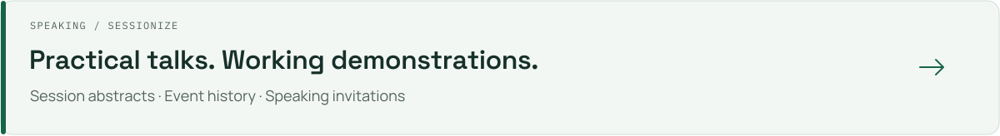
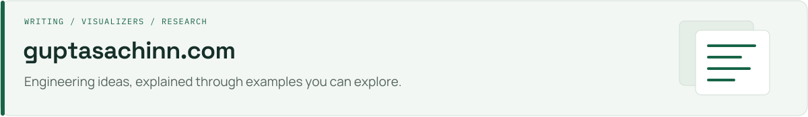
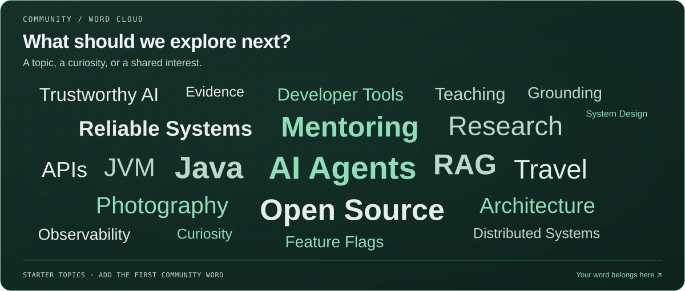

<picture>
  <source media="(max-width: 600px)" srcset="./assets/profile/cover-mobile.svg" />
  
</picture>

<picture>
  <source media="(max-width: 600px)" srcset="./assets/profile/credentials-mobile.svg" />
  
</picture>

I'm a **Member of Technical Staff 2 in eBay Monetization**, based in San Jose, California. Over **15+ years**, I've built and modernized systems across financial services, healthcare, and enterprise software — environments where correctness, reliability, and operational judgment matter.

My work spans production engineering, applied research, open-source tools, and technical education. I have **9 accepted papers**, speak at engineering conferences, and publish practical explanations and interactive visualizers on **[guptasachinn.com](https://www.guptasachinn.com/)**.

  
  
  
  

---

##  Engineering & technical leadership

At **eBay**, I work in **Monetization**. My work spans platform modernization, microservices, public APIs, and reconciliation pipelines. My responsibilities have included leading the seller-and-balance migration, rebuilding the public API layer, and driving AI-enablement through data contracts, observability, and governance.

Earlier, at **Tata Consultancy Services**, I built systems for **Walgreens** across specialty pharmacy and merchandising, and worked on **NSDL's e-Voting platform**. Those experiences shaped my approach to architecture: understand the domain, make failures visible, and build systems people can operate with confidence.

**Core areas:** monetization · Java & JVM systems · API modernization · reconciliation · platform reliability · AI governance.

[More about my work and career](https://www.guptasachinn.com/about)

##  Research — 9 accepted papers

My research focuses on **trustworthy AI agents, grounded generation, evaluation, and developer tooling**. I connect research questions to working software, explicit checks, and reproducible artifacts.

All nine accepted papers are listed below. Published work links to the publisher record; AgentTrustCI and ToolContractGate link to their public arXiv manuscripts.

|  |  |  |  |
| :--- | :--- | :--- | :---: |
| **HeapLens** 01 · JVM developer tooling | IDE-integrated heap analysis, source bridging, and assisted diagnosis | **SPLASH 2026** Companion · Tool Demonstrations  |  |
| **AgentTrustCI** 02 · Agent assurance | Policy, grounding, and tool-trajectory regression tests for Java agents | **IEEE ICCA 2026** Industrial Track  |  |
| **ToolContractGate** 03 · Tool contracts | Versioned contracts for drift-safe agent tool invocation | **IEEE ICCA 2026** Industrial Track  |  |
| **ScamShield / SMS audit** 04 · SMS evaluation | Policy-aligned evaluation of false positives in Indian financial SMS | **EMNLP 2026** GroundLM workshop  |  |
| **SlideSherlock** 05 · Grounded narration | Evidence-indexed narration with heuristic checks and template fallback | **EMNLP 2026** GroundLM workshop  |  |
| **VERITYGATE** 06 · Faithfulness | Schema-level faithfulness checks over structured evidence | **EMNLP 2026** GroundLM workshop  |  |
| **TRACE** 07 · Evidence retrieval | Target-aware retrieval and contract-constrained extraction for LitTraceQA | **EMNLP 2026** GroundLM workshop · Shared task  |  |
| **EVICALC** 08 · Document reasoning | Evidence extraction and arithmetic for the DocSem shared task | **EMNLP 2026** DocInsights workshop · Shared task  |  |
| **RouteGuard** 09 · Selective classification | Cost-aware abstention for LLM-based IT ticket classification | **IEEE ICTAI 2026** Full paper  |  |

[Research on my website](https://www.guptasachinn.com/highlights) · [Google Scholar](https://scholar.google.com/citations?user=sVZi4aoAAAAJ&hl=en) · [ORCID](https://orcid.org/0009-0009-7422-4967)

##  Speaking & sessions

  

I speak about the engineering decisions behind reliable platforms and trustworthy AI: how to modernize systems, roll out agent behavior safely, and turn governance into checks that run in CI and at runtime.

My speaking work includes **AI Engineer World's Fair, WeAreDevelopers, PlatformCon, and DeveloperWeek**. My sessions combine an engineering problem, the tradeoffs involved, and an implementation people can inspect or adapt.

Topics I cover include:

- **AI agent governance** — policy, grounding, tool-use trajectories, and versioned tool contracts.
- **Safe agent rollouts** — feature flags, staged adoption, autonomy controls, and kill switches.
- **Backend architecture & modernization** — OpenAPI-to-MCP integration and choosing domain-driven design patterns that earn their complexity.

**[View my Sessionize profile, session abstracts & event history](https://sessionize.com/sachin-gupta/)** · [Watch: Agents Need Feature Flags](https://www.youtube.com/watch?v=zU4EagB311U) · [WeAreDevelopers talk](https://www.guptasachinn.com/activities/wearedevelopers)

##  My website — guptasachinn.com

  

**[guptasachinn.com](https://www.guptasachinn.com/)** is my home for engineering writing, interactive explanations, research, talks, and career work. I use examples, diagrams, and working visualizers to explain the mechanisms behind a system and the tradeoffs involved in building it.

- **[RAG field guide](https://www.guptasachinn.com/tags/rag)** — retrieval, grounding, citations, and when to abstain.
- **[Inference explained](https://www.guptasachinn.com/writing/dspark)** — speculative decoding and DSpark through visual explanations.
- **[Interactive visualizers](https://www.guptasachinn.com/visualizers)** — explore engineering concepts by changing the inputs.

[Explore my website](https://www.guptasachinn.com/) · [Read on Medium](https://medium.com/@sachinkg12)

##  Open-source work

I build tools around the same questions I encounter in engineering and research: what is happening, what evidence supports an answer, and which actions should be allowed?

|  |  |  |
| :--- | :--- | :---: |
| **[HeapLens](https://github.com/sachinkg12/heaplens)** JVM diagnostics | Java and Android heap analysis across VS Code, IntelliJ IDEA, and the terminal/browser, backed by a native Rust engine. |  |
| **[ToolContractGate](https://github.com/sachinkg12/toolcontractgate)** Agent tool governance | A deterministic gate that checks AI tool calls against approved, versioned contracts. |  |
| **[SlideSherlock](https://github.com/sachinkg12/SlideSherlock)** Evidence-based media | A pipeline for turning slides into narrated video with source evidence and provenance. |  |
| **[AgentTrustCI](https://github.com/sachinkg12/agenttrustci)** Agent regression testing | Experimental JUnit checks for agent policy, answer grounding, and tool-use sequences. |  |
| **[RouteGuard](https://github.com/sachinkg12/RouteGuard)** Selective classification | A reproducible framework for evaluating classification, abstention, and asymmetric error costs. |  |

  

Snapshot: November 6, 2026 · [VS Code Marketplace: 12,367 downloads; 2,215 installs](https://marketplace.visualstudio.com/items?itemName=guptasachinn.heaplens) · [Open VSX: 12,966 downloads](https://open-vsx.org/extension/guptasachinn/heaplens) · [JetBrains: 37 downloads](https://plugins.jetbrains.com/plugin/35004-heaplens). Download counts measure distribution, not unique users.

##  Reviewing & research service

I contribute as a research reviewer, Area Chair, and artifact evaluator. Selected roles, with the conference and workshop scope stated explicitly:

|  |  |
| :--- | :--- |
| **NeurIPS 2026** Workshop service |  Workshop reviewer for [Agents in the Wild](https://agentwild-workshop.github.io/neurips2026/), [Global South AI](https://sites.google.com/view/globalsouthai-neurips26/home), and [VLM4RWD](https://vlm4rwd.github.io/). |
| **ICML 2026** Workshop service |  Workshop reviewer for [Agents in the Wild](https://agentwild-workshop.github.io/icml2026/) and [Trustworthy AI for Good](https://trustworthy-ai-for-good.github.io/). |
| **ACL & EMNLP 2026** Workshop & industry service |  **[GroundLM workshop at EMNLP](https://groundlm.github.io/grouplm_emnlp2026/)**   [LT-EDI workshop at ACL](https://sites.google.com/view/lt-edi-2026/home) · [EMNLP Industry Track](https://2026.emnlp.org/calls/industry_track/) · [REALM workshop at EMNLP](https://realm-workshop.github.io/). |
| **COLM 2026** Workshop service |  Reviewer for the [Efficient Reasoning workshop](https://wdlctc.github.io/efficient-reasoning-2026/). |
| **ACM / IEEE** Evaluation & peer review |  **ASE, CAV, ACSAC, and CAIS**  Peer review for **IEEE Access** · Program committees for **IEEE BigData** and **IEEE ICA**. |

[Reviewing & community record](https://www.guptasachinn.com/highlights)

##  Mentoring & community

**Recognized as a Top 1% Mentor on ADPList for October 2026.**

I mentor students and engineers on technical growth, career decisions, and building practical skills. I also support university hackathons and teams building software for nonprofits, including **Weber State University** and **Opportunity Hack**.

[Mentoring on ADPList](https://adplist.org/mentors/sachin-gupta-mpepaxnr) · [Community work](https://www.guptasachinn.com/highlights)

##  Community word cloud

**What should we explore next?** Add a topic, a curiosity, or a shared interest — from AI agents and Java to photography and travel.

<picture>
  <source media="(max-width: 600px)" srcset="./assets/profile/wordcloud-mobile.svg" />
  
</picture>

**[Add your word](https://github.com/sachinkg12/sachinkg12/issues/new?template=wordcloud.yml)** · [See community submissions](https://github.com/sachinkg12/sachinkg12/issues?q=is%3Aissue%20%22%5Bwordcloud%5D%22%20in%3Atitle)

The cloud starts with my interests. Your latest submission contributes one word; matching words grow as more people choose them. Submit through GitHub and the cloud refreshes automatically.

##  Beyond engineering

I travel with my family and photograph landscapes, cities, and the moments between destinations. Teaching, mentoring, and exploring new places are part of how I stay curious.

For technical collaboration, research conversations, or speaking invitations, **[connect on LinkedIn](https://www.linkedin.com/in/guptasachin1/)** or **[find me on Sessionize](https://sessionize.com/sachin-gupta/)**.

San Jose, California · Open-source work and views shared in a personal capacity.
