<picture>
  <source media="(max-width: 600px)" srcset="./assets/profile/cover-mobile.svg" />
  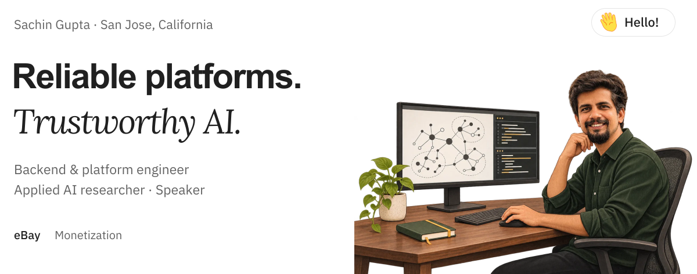
</picture>

<picture>
  <source media="(max-width: 600px)" srcset="./assets/profile/credentials-mobile.svg" />
  
</picture>

I'm a **Member of Technical Staff 2 in eBay Monetization**, based in San Jose, California. Over **15+ years**, I've built and modernized systems across financial services, healthcare, and enterprise software — environments where correctness, reliability, and operational judgment matter.

My work spans production engineering, applied research, open-source tools, and technical education. I have **9 accepted papers**, speak at engineering conferences, and publish practical explanations and interactive visualizers on **[guptasachinn.com](https://www.guptasachinn.com/)**. I’m also a **[keynote speaker at SCIS 2026](https://scrs.in/conference/scis2026/speaker/talk/23367)** (November 21–22, 2026).

  
  
  
  

<!-- heading:engineering-technical-leadership:start -->

<h3 class="section-heading" id="engineering-technical-leadership">
<picture><source media="(max-width: 600px)" srcset="./assets/profile/headings/engineering-technical-leadership-mobile.svg" />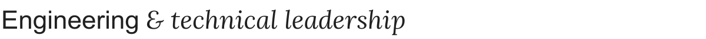</picture>
</h3>
<!-- heading:engineering-technical-leadership:end -->

At **eBay**, I work in **Monetization**. My work spans platform modernization, microservices, public APIs, and reconciliation pipelines. My responsibilities have included leading the seller-and-balance migration, rebuilding the public API layer, and driving AI-enablement through data contracts, observability, and governance.

Earlier, at **Tata Consultancy Services**, I built systems for **Walgreens** across specialty pharmacy and merchandising, and worked on **NSDL's e-Voting platform**. Those experiences shaped my approach to architecture: understand the domain, make failures visible, and build systems people can operate with confidence.

**Core areas:** monetization · Java & JVM systems · API modernization · reconciliation · platform reliability · AI governance.

[More about my work and career](https://www.guptasachinn.com/about)

<!-- heading:research-9-accepted-papers:start -->

<h3 class="section-heading" id="research-9-accepted-papers">
<picture><source media="(max-width: 600px)" srcset="./assets/profile/headings/research-9-accepted-papers-mobile.svg" /></picture>
</h3>
<!-- heading:research-9-accepted-papers:end -->

My research focuses on **trustworthy AI agents, grounded generation, evaluation, and developer tooling**. I connect research questions to working software, explicit checks, and reproducible artifacts.

All nine accepted papers are listed below. Published work links to the publisher record; AgentTrustCI and ToolContractGate link to their public arXiv manuscripts.

<!-- research:start -->

<a href="https://dl.acm.org/doi/10.1145/3837729.3840479"><picture><source media="(max-width: 600px)" srcset="./assets/profile/research/paper-01-mobile.svg" />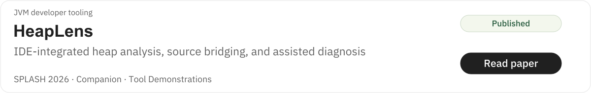</picture></a>

<a href="https://arxiv.org/abs/2611.06674"><picture><source media="(max-width: 600px)" srcset="./assets/profile/research/paper-02-mobile.svg" />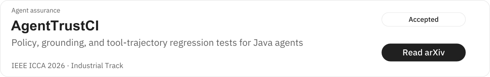</picture></a>

<a href="https://arxiv.org/abs/2610.33108"><picture><source media="(max-width: 600px)" srcset="./assets/profile/research/paper-03-mobile.svg" />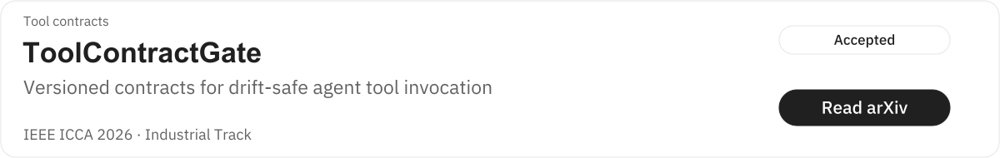</picture></a>

<a href="https://aclanthology.org/2026.groundlm-1.79/"><picture><source media="(max-width: 600px)" srcset="./assets/profile/research/paper-04-mobile.svg" />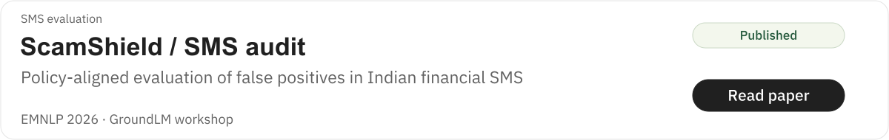</picture></a>

<a href="https://aclanthology.org/2026.groundlm-1.78/"><picture><source media="(max-width: 600px)" srcset="./assets/profile/research/paper-05-mobile.svg" />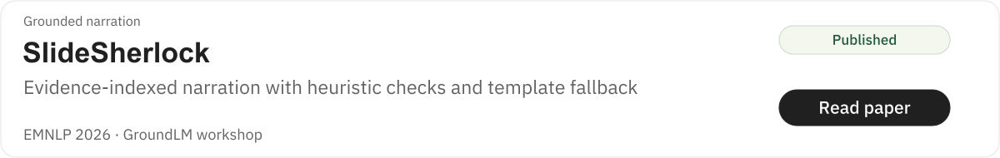</picture></a>

<a href="https://aclanthology.org/2026.groundlm-1.5/"><picture><source media="(max-width: 600px)" srcset="./assets/profile/research/paper-06-mobile.svg" />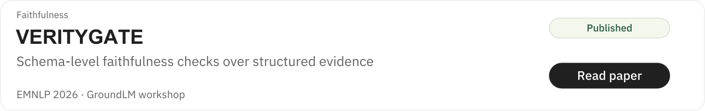</picture></a>

<a href="https://aclanthology.org/2026.groundlm-1.86/"><picture><source media="(max-width: 600px)" srcset="./assets/profile/research/paper-07-mobile.svg" />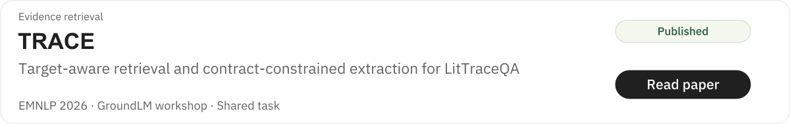</picture></a>

<a href="https://aclanthology.org/2026.docinsights-1.32/"><picture><source media="(max-width: 600px)" srcset="./assets/profile/research/paper-08-mobile.svg" />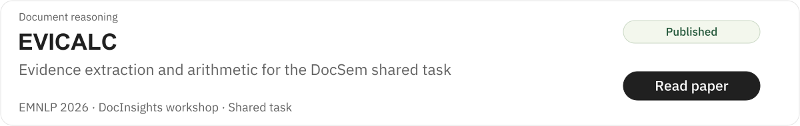</picture></a>

<a href="https://conferences.computer.org/ictaipub26/pdfs/4880-1wRFtuxgVBHgn8UZdUtTn4/488001a271/488001a271.pdf"><picture><source media="(max-width: 600px)" srcset="./assets/profile/research/paper-09-mobile.svg" />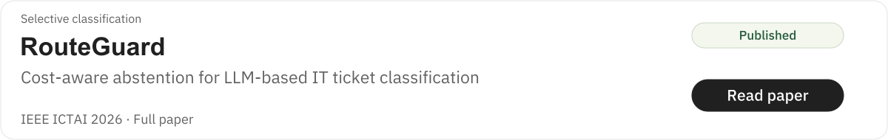</picture></a>

<!-- research:end -->

[Research on my website](https://www.guptasachinn.com/highlights) · [Google Scholar](https://scholar.google.com/citations?user=sVZi4aoAAAAJ&hl=en) · [ORCID](https://orcid.org/0009-0009-7422-4967)

<!-- heading:speaking-sessions:start -->

<h3 class="section-heading" id="speaking-sessions">
<picture><source media="(max-width: 600px)" srcset="./assets/profile/headings/speaking-sessions-mobile.svg" /></picture>
</h3>
<!-- heading:speaking-sessions:end -->

<!-- keynote:start -->

<a href="https://scrs.in/conference/scis2026/speaker/talk/23367"><picture><source media="(max-width: 600px)" srcset="./assets/profile/keynote-card-mobile.svg" />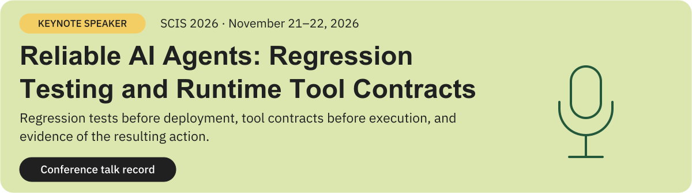</picture></a>

<!-- keynote:end -->

  <a href="https://sessionize.com/sachin-gupta/"><picture><source media="(max-width: 600px)" srcset="./assets/profile/speaking-card-mobile.svg" />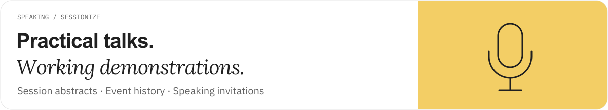</picture></a>

I speak about the engineering decisions behind reliable platforms and trustworthy AI: how to modernize systems, roll out agent behavior safely, and turn governance into checks that run in CI and at runtime.

My speaking work includes **AI Engineer World's Fair, WeAreDevelopers, PlatformCon, and DeveloperWeek**. My sessions combine an engineering problem, the tradeoffs involved, and an implementation people can inspect or adapt.

Topics I cover include:

- **AI agent governance** — policy, grounding, tool-use trajectories, and versioned tool contracts.
- **Safe agent rollouts** — feature flags, staged adoption, autonomy controls, and kill switches.
- **Backend architecture & modernization** — OpenAPI-to-MCP integration and choosing domain-driven design patterns that earn their complexity.

**[View my Sessionize profile, session abstracts & event history](https://sessionize.com/sachin-gupta/)** · [Watch: Agents Need Feature Flags](https://www.youtube.com/watch?v=zU4EagB311U) · [WeAreDevelopers talk](https://www.guptasachinn.com/activities/wearedevelopers)

<!-- heading:my-website-guptasachinn-com:start -->

<h3 class="section-heading" id="my-website-guptasachinn-com">
<picture><source media="(max-width: 600px)" srcset="./assets/profile/headings/my-website-guptasachinn-com-mobile.svg" /></picture>
</h3>
<!-- heading:my-website-guptasachinn-com:end -->

  <a href="https://www.guptasachinn.com/"><picture><source media="(max-width: 600px)" srcset="./assets/profile/website-card-mobile.svg" />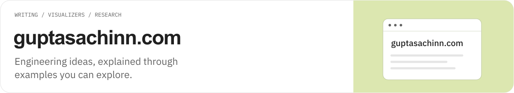</picture></a>

  <a href="https://sachinkg12.github.io/"><picture><source media="(max-width: 600px)" srcset="./assets/profile/portfolio-card-mobile.svg" />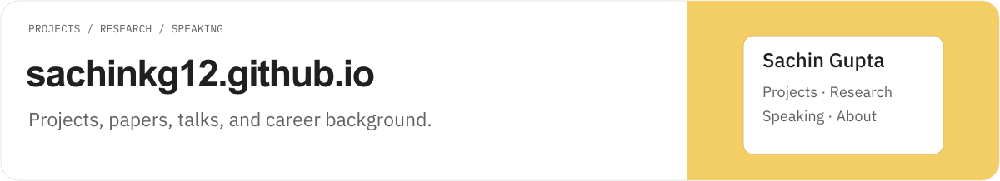</picture></a>

**[sachinkg12.github.io](https://sachinkg12.github.io/)** is my portfolio for projects, research papers, speaking, and career background.

**[guptasachinn.com](https://www.guptasachinn.com/)** is my home for engineering writing, interactive explanations, research, talks, and career work. I use examples, diagrams, and working visualizers to explain the mechanisms behind a system and the tradeoffs involved in building it.

- **[RAG field guide](https://www.guptasachinn.com/tags/rag)** — retrieval, grounding, citations, and when to abstain.
- **[Inference explained](https://www.guptasachinn.com/writing/dspark)** — speculative decoding and DSpark through visual explanations.
- **[Interactive visualizers](https://www.guptasachinn.com/visualizers)** — explore engineering concepts by changing the inputs.

[Explore my website](https://www.guptasachinn.com/) · [Read on Medium](https://medium.com/@sachinkg12)

<!-- heading:open-source-work:start -->

<h3 class="section-heading" id="open-source-work">
<picture><source media="(max-width: 600px)" srcset="./assets/profile/headings/open-source-work-mobile.svg" /></picture>
</h3>
<!-- heading:open-source-work:end -->

I build tools around the same questions I encounter in engineering and research: what is happening, what evidence supports an answer, and which actions should be allowed?

<!-- projects:start -->

<a href="https://github.com/sachinkg12/heaplens"><picture><source media="(max-width: 600px)" srcset="./assets/profile/projects/project-01-mobile.svg" />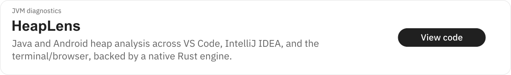</picture></a>

<a href="https://github.com/sachinkg12/toolcontractgate"><picture><source media="(max-width: 600px)" srcset="./assets/profile/projects/project-02-mobile.svg" />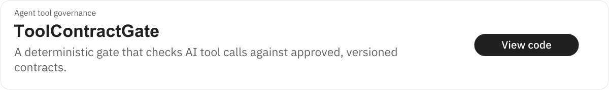</picture></a>

<a href="https://github.com/sachinkg12/SlideSherlock"><picture><source media="(max-width: 600px)" srcset="./assets/profile/projects/project-03-mobile.svg" />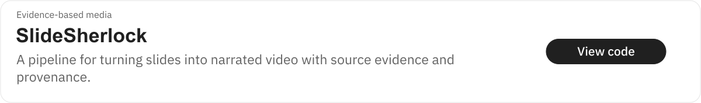</picture></a>

<a href="https://github.com/sachinkg12/agenttrustci"><picture><source media="(max-width: 600px)" srcset="./assets/profile/projects/project-04-mobile.svg" />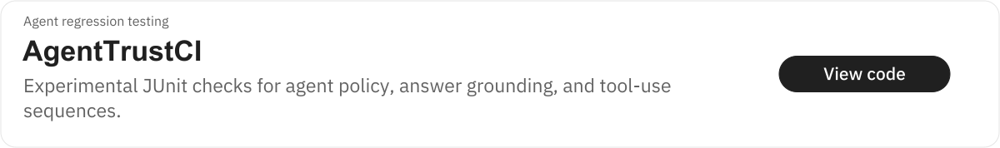</picture></a>

<a href="https://github.com/sachinkg12/RouteGuard"><picture><source media="(max-width: 600px)" srcset="./assets/profile/projects/project-05-mobile.svg" />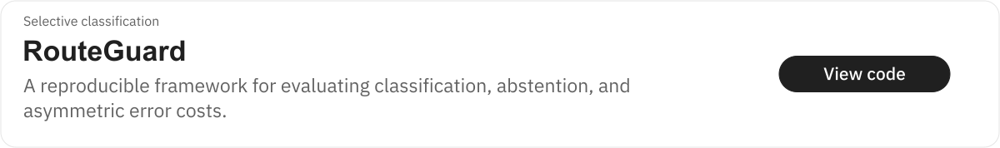</picture></a>

<!-- projects:end -->

<!-- heaplens-stats:start -->

<h3 class="section-heading" id="heaplens-marketplace-activity">
<picture><source media="(max-width: 600px)" srcset="./assets/profile/headings/heaplens-marketplace-activity-mobile.svg" /></picture>
</h3>

  <a href="https://github.com/sachinkg12/heaplens"><picture><source media="(max-width: 600px)" srcset="./assets/profile/heaplens-adoption-mobile.svg" />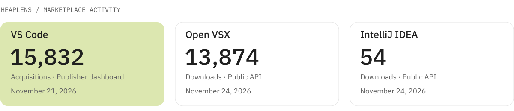</picture></a>

<!-- heaplens-stats:end -->

<!-- heading:reviewing-research-service:start -->

<h3 class="section-heading" id="reviewing-research-service">
<picture><source media="(max-width: 600px)" srcset="./assets/profile/headings/reviewing-research-service-mobile.svg" /></picture>
</h3>
<!-- heading:reviewing-research-service:end -->

I contribute as a research reviewer, Area Chair, and artifact evaluator. Selected roles, with the conference and workshop scope stated explicitly:

<!-- reviewing:start -->
### NeurIPS 2026

Workshop service

**Reviewer** ·  Workshop reviewer for [Agents in the Wild](https://agentwild-workshop.github.io/neurips2026/), [Global South AI](https://sites.google.com/view/globalsouthai-neurips26/home), and [VLM4RWD](https://vlm4rwd.github.io/).

### ICML 2026

Workshop service

**Reviewer** ·  Workshop reviewer for [Agents in the Wild](https://agentwild-workshop.github.io/icml2026/) and [Trustworthy AI for Good](https://trustworthy-ai-for-good.github.io/).

### ACL & EMNLP 2026

Workshop & industry service

**Area Chair** ·  **[GroundLM workshop at EMNLP](https://groundlm.github.io/grouplm_emnlp2026/)**

**Reviewer** ·  [LT-EDI workshop at ACL](https://sites.google.com/view/lt-edi-2026/home) · [EMNLP Industry Track](https://2026.emnlp.org/calls/industry_track/) · [REALM workshop at EMNLP](https://realm-workshop.github.io/).

### COLM 2026

Workshop service

**Reviewer** ·  Reviewer for the [Efficient Reasoning workshop](https://wdlctc.github.io/efficient-reasoning-2026/).

### ACM / IEEE

Evaluation & peer review

**Artifact evaluation** ·  **ASE, CAV, ACSAC, and CAIS**

Peer review for **IEEE Access** · Program committees for **IEEE BigData** and **IEEE ICA**.
<!-- reviewing:end -->

[Reviewing & community record](https://www.guptasachinn.com/highlights)

<!-- heading:mentoring-community:start -->

<h3 class="section-heading" id="mentoring-community">
<picture><source media="(max-width: 600px)" srcset="./assets/profile/headings/mentoring-community-mobile.svg" /></picture>
</h3>
<!-- heading:mentoring-community:end -->

**Recognized as a Top 1% Mentor on ADPList for October 2026.**

I mentor students and engineers on technical growth, career decisions, and building practical skills. I also support university hackathons and teams building software for nonprofits, including **Weber State University** and **Opportunity Hack**.

[Mentoring on ADPList](https://adplist.org/mentors/sachin-gupta-mpepaxnr) · [Community work](https://www.guptasachinn.com/highlights)

<!-- heading:community-word-cloud:start -->

<h3 class="section-heading" id="community-word-cloud">
<picture><source media="(max-width: 600px)" srcset="./assets/profile/headings/community-word-cloud-mobile.svg" /></picture>
</h3>
<!-- heading:community-word-cloud:end -->

**What should we explore next?** Add a topic, a curiosity, or a shared interest — from AI agents and Java to photography and travel.

<picture>
  <source media="(max-width: 600px)" srcset="./assets/profile/wordcloud-mobile.svg" />
  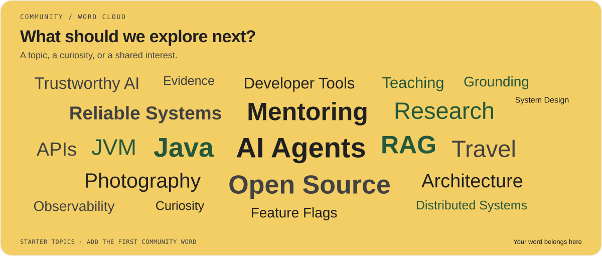
</picture>

**[Add your word](https://github.com/sachinkg12/sachinkg12/issues/new?template=wordcloud.yml)** · [See community submissions](https://github.com/sachinkg12/sachinkg12/issues?q=is%3Aissue%20%22%5Bwordcloud%5D%22%20in%3Atitle)

The cloud starts with my interests. Your latest submission contributes one word; matching words grow as more people choose them. Submit through GitHub and the cloud refreshes automatically.

<!-- heading:beyond-engineering:start -->

<h3 class="section-heading" id="beyond-engineering">
<picture><source media="(max-width: 600px)" srcset="./assets/profile/headings/beyond-engineering-mobile.svg" />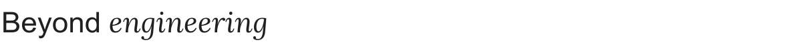</picture>
</h3>
<!-- heading:beyond-engineering:end -->

I travel with my family and photograph landscapes, cities, and the moments between destinations. Teaching, mentoring, and exploring new places are part of how I stay curious.

For technical collaboration, research conversations, or speaking invitations, **[connect on LinkedIn](https://www.linkedin.com/in/guptasachin1/)** or **[find me on Sessionize](https://sessionize.com/sachin-gupta/)**.

San Jose, California · Open-source work and views shared in a personal capacity.
